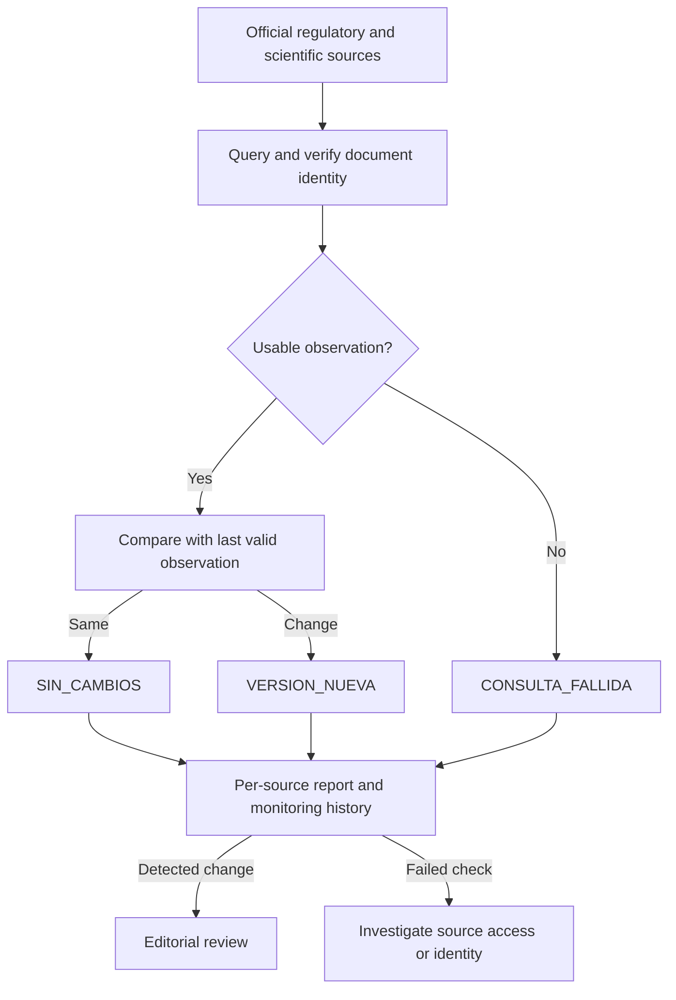

# From source observation to editorial review

## Operational system

The query method depends on how the authority publishes a source. For example, a consolidated EU act can be identified by its dated CELEX record, while a new item in a scientific feed has a publication identifier.

A detection event has its own identity and review status. A repeated observation can therefore be unchanged while an earlier event is still awaiting review. The private workflow preserves monitoring outputs separately from the catalogue. Only an editorial decision can incorporate a source.

## Executable slice

| Component | Public implementation |
| --- | --- |
| Source registry | A synthetic document ID and the last successful release date per watcher. |
| Acquisition boundary | A local observation fixture supplies the response a connector would hand to the comparator. |
| Comparison | Python checks document identity, valid calendar dates, regressions and future dates. |
| Classification | Each watcher yields one of the three outcomes and a reason. |
| Evidence | JSON retains the inputs’ fingerprints, scenario date, source identifiers and decision per watcher. |
| Review handoff | A later date yields `request_editorial_review`. A failure yields `investigate_and_retry`. These are recorded actions for a person. |

The public replay starts from a populated baseline on every run. Persistent observations, network transport, change-event deduplication and the editorial catalogue belong to the operational system. The demonstration runs with read-only inputs.
